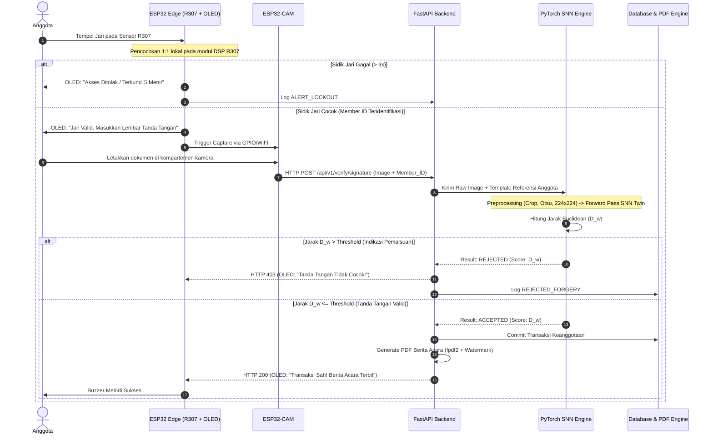

# Evaluasi Tengah Semester (ETS) Riset Informatika

> **Proposal Penelitian Tugas Akhir / Skripsi S1 Informatika**  
> **Fakultas Ilmu Komputer, UPN "Veteran" Jawa Timur**

---

## 📌 Identitas Mahasiswa & Akademik

* **Nama Mahasiswa:** Jonathan Abimael Sutanto  
* **NIM:** 23081010128  
* **Program Studi:** S1 Informatika  
* **Fakultas:** Ilmu Komputer  
* **Institusi:** Universitas Pembangunan Nasional "Veteran" Jawa Timur  
* **Mata Kuliah:** Riset Informatika
* **Dosen Pengampu:** Dr. Basuki Rahmat, S.Si, MT  
* **Semester / Tahun:** Ganjil / 2026  

---

## 🎯 Judul Penelitian

> **"Rancang Bangun Kiosk Biometrik Berbasis IoT dengan Verifikasi Tanda Tangan Menggunakan Siamese Neural Network untuk Keanggotaan Koperasi"**

* **Bidang Minat / Peminatan:** Internet of Things (IoT) & Kecerdasan Buatan / Deep Learning (Computer Vision)
* **Peminatan Silang:** Rekayasa Perangkat Lunak (Software Engineering)

---

## 📝 Ringkasan Eksekutif (Executive Summary)

Pemalsuan tanda tangan pada warkat administrasi simpan pinjam, mutasi tugas, dan pengunduran diri anggota koperasi di lingkungan kedinasan, seperti Pusat Koperasi Kepolisian (Puskopol) dan Induk Koperasi Kepolisian (INKOPPOL), menimbulkan risiko kerugian finansial material serta sengketa yuridis yang merugikan kredibilitas institusi. Praktik verifikasi manual oleh petugas loket memiliki kelemahan mendasar karena ketidakmampuan mata telanjang mendeteksi pemalsuan tingkat mahir (*skilled forgery*) yang meniru morfologi tanda tangan asli. Di samping itu, sistem biometrik tunggal (*unimodal*) seperti sidik jari semata tidak meninggalkan dokumen persetujuan formal bernilai hukum, sedangkan tanda tangan kertas semata tidak memiliki bukti kehadiran fisik waktu nyata (*proof of presence*).

Penelitian ini mengusulkan solusi terpadu berupa rancang bangun **Kiosk Biometrik Mandiri Berbasis Internet of Things (IoT)** yang mengintegrasikan verifikasi dwi-modalitas: biometrik fisiologis sidik jari dan biometrik perilaku tanda tangan statis (*offline signature*). Perangkat keras kiosk dirancang kompak dan berdaya rendah menggunakan mikrokontroler **ESP32 WROOM-32** sebagai *master controller*, modul sensor sidik jari optik **GROW R307** dengan komunikasi serial UART level logika TTL untuk pencocokan 1:1 *onboard*, modul kamera **ESP32-CAM (OV2640)** beresolusi terkontrol untuk akuisisi citra tanda tangan basah, layar OLED 0.96 inci I2C, serta *audio buzzer* aktif. 

Di sisi peladen (*server*), layanan backend **FastAPI** mengorkestrasi inferensi *Deep Learning* menggunakan arsitektur **Siamese Neural Network (SNN)** (*twin networks* dengan *shared weights* berbasis MobileNetV2/ResNet-18) yang dioptimasi menggunakan fungsi objektif **Contrastive Loss** untuk menghitung jarak Euclidean antar-vektor representasi (*embedding*). Pendekatan *writer-independent* diterapkan agar sistem mampu memverifikasi anggota baru secara *zero-shot* tanpa pelatihan ulang model. Sistem secara otomatis menerbitkan dokumen **Berita Acara Transaksi digital berformat PDF** bertanda air dan mencatat jejak audit (*audit trail*) terenkapsulasi ke basis data.

---

## 🏛️ Arsitektur Sistem & Alur Transaksi



---

## 🔬 State-of-the-Art (SOTA) & Research Gap

| No | Peneliti & Tahun | Metode / Algoritma | Modalitas | Platform | Keterbatasan & Celah (*Research Gap*) |
|:--:|:---|:---|:---|:---|:---|
| 1 | **Andani et al. (2020)** *JTIKA UNRAM* | Local Binary Pattern (LBP) + LVQ | Tanda Tangan Offline | Software Desktop | Akurasi rendah (63%), *closed-set* (*writer-dependent*), rentan *skilled forgery*, tanpa perangkat IoT. |
| 2 | **Mudjirahardjo et al. (2019)** *Jurnal EECCIS (UB)* | GLCM + LBP + Euclidean Distance | Tanda Tangan Offline | Software Desktop | Fokus identifikasi tertutup, bukan verifikasi keaslian; sangat sensitif terhadap variasi rotasi tulisan. |
| 3 | **Pradana & Asmara (2024)** *JSAI (UMB)* | Hu Moments + HOG + SVM | Tanda Tangan Digital | Desktop Python | Wajib melatih ulang model setiap ada penambahan subjek baru (*closed-set*); fitur manual rentan noise kamera. |
| 4 | **Mayda & Musdholifah (2022)** *IJCCS (UGM)* | Siamese CNN (ResNet-18) + Contrastive Loss | Tanda Tangan Offline | Server GPU | Hanya simulasi komputasi pada benchmark publik (CEDAR); tanpa perangkat keras akuisisi fisik terpasang. |
| 5 | **Saputra et al. (2023)** *Telekontran (UNIKOM)* | Minutiae Matching Sensor AS608 | Sidik Jari | ESP32 + LCD | *Single modality*, rawan kegagalan baca mekanik sensor, tanpa verifikasi dokumen legalitas formal. |
| 6 | **Surya et al. (2024)** *JENTIK (Poltek Kampar)* | Template Matching + ESP32-CAM | Sidik Jari + Foto | ESP32-CAM + Fingerprint | Kamera hanya mengambil foto log visual tanpa inferensi AI cerdas; use-case presensi dasar. |
| 7 | **Fatkhudin et al. (2022)** *Jurnal RESTI* | Role-Based Access Control + Web CRUD | Non-Biometrik | Web Server PHP | Autentikasi konvensional password/PIN sangat rentan manipulasi dan pinjaman fiktif. |
| 8 | **Penelitian Ini (Diusulkan)** | **Siamese CNN (Contrastive) + R307 1:1 UART** | **Sidik Jari + Tanda Tangan** | **Kiosk ESP32 + FastAPI Backend** | **Solusi terpadu: Kiosk IoT mandiri berbiaya terjangkau + Deep Metric Learning writer-independent + Berita Acara PDF otomatis.** |

### Kebaruan Akademik (*Novelty Statement*)
> *"Penelitian ini menghadirkan kebaruan sistemik (systemic novelty) melalui rancang bangun Kiosk Biometrik Mandiri Berbasis IoT yang mengintegrasikan akuisisi fisik multisensor secara nirkabel (ESP32, R307, ESP32-CAM) dengan mesin inferensi Siamese Neural Network berparadigma writer-independent pada peladen backend. Keunggulan arsitektural ini memungkinkan sistem memverifikasi keabsahan tanda tangan anggota baru secara zero-shot (cukup membandingkan jarak embedding $\mathcal{L}_2$ tanda tangan uji terhadap warkat referensi saat registrasi tanpa pelatihan ulang model), memitigasi risiko pinjaman fiktif melalui pengikatan biometrik ganda (kehadiran fisik dan kesadaran yuridis), serta menerbitkan dokumen Berita Acara transaksi terenkapsulasi secara otomatis dan real-time."*

---

## 🛠️ Spesifikasi Perangkat Keras & Estimasi Biaya (BOM)

| No | Komponen / Modul | Spesifikasi Teknis | Kuantitas | Harga Satuan (IDR) | Total (IDR) |
|:--:|:---|:---|:---:|:---:|:---:|
| 1 | **ESP32 WROOM-32** | DevKit V1 38-Pin, Wi-Fi 2.4GHz + BLE | 1 unit | Rp 65.000 | Rp 65.000 |
| 2 | **ESP32-CAM + OV2640** | Sensor 2MP, 4MB PSRAM, FTDI Programmer | 1 unit | Rp 85.000 | Rp 85.000 |
| 3 | **GROW R307 Optical Sensor** | 500 DPI, UART 57600 bps, DSP Onboard | 1 unit | Rp 165.000 | Rp 165.000 |
| 4 | **OLED Display 0.96 inch** | 128x64 pixels, Interface I2C SSD1306 | 1 unit | Rp 28.000 | Rp 28.000 |
| 5 | **Adaptor Switching 5V 3A** | Jack DC 5.5mm + Kabel Pembagi Daya | 1 unit | Rp 38.000 | Rp 38.000 |
| 6 | **Piezo Buzzer & Push Button** | Active Buzzer 5V + Sakelar Taktil 12mm | 1 paket | Rp 12.000 | Rp 12.000 |
| 7 | **LED Strip 5V + Difusor** | SMD 2835 Cool White + Akrilik Buram | 1 paket | Rp 18.000 | Rp 18.000 |
| 8 | **Kabel Jumper & PCB Matrix** | Kabel Silikon, Header Pin, Kapasitor 1000uF | 1 paket | Rp 15.000 | Rp 15.000 |
| 9 | **Enclosure Boks Akrilik** | Akrilik Hitam 3mm Cutting Laser Presisi | 1 unit | Rp 45.000 | Rp 45.000 |
| **Total** | **Bill of Materials (BOM) Kiosk Hardware** | | | | **Rp 471.000** |

---

## 📊 Metrik Evaluasi Pengujian

1. **Metrik Biometrik & Machine Learning:**
   * **False Acceptance Rate (FAR):** $\text{FAR} = \frac{FP}{FP + TN}$
   * **False Rejection Rate (FRR):** $\text{FRR} = \frac{FN}{TP + FN}$
   * **Equal Error Rate (EER):** Titik potong optimal saat $\text{FAR} = \text{FRR}$ pada kurva ROC (*Receiver Operating Characteristic*).
   * **ROC-AUC:** Area di bawah kurva ROC untuk mengevaluasi ketahanan model terhadap variasi threshold $\tau \in [0.2, 1.2]$.
   * **Skenario Pengujian:** *Intra-class* (Asli vs Asli), *Random Forgery* (Asli subjek A vs Asli subjek B), dan *Skilled Forgery* (Asli vs Tiruan Terampil oleh 3 peniru terlatih).

2. **Metrik Performa IoT & Jaringan:**
   * **End-to-End Latency:** $T_{\text{total}} = T_{\text{capture}} + T_{\text{transfer\_up}} + T_{\text{preprocess}} + T_{\text{inferensi}} + T_{\text{transfer\_down}} + T_{\text{oled}}$ (Target $< 2.5\text{ detik}$).
   * **Kecepatan Pencocokan Sidik Jari:** DSP onboard R307 ($< 300\text{ ms}$).
   * **Quality of Service (QoS) Wi-Fi:** Throughput & Packet Loss pada jarak 1m, 5m, dan 10m (*Line-of-Sight* dan *Non-Line-of-Sight*).
   * **Konsumsi Daya:** Pengukuran arus rata-rata (mA) pada mode *standby* vs *active capture/transmission*.

3. **Metrik Fungsionalitas & Penerimaan Pengguna:**
   * **Black-Box Testing:** Menggunakan metode Boundary Value Analysis (BVA) dan Equivalence Partitioning (EP) pada seluruh endpoint API FastAPI.
   * **System Usability Scale (SUS):** Kuesioner baku 10 butir (Brooke, 1996) kepada staf pengurus dan kasir koperasi (Target skor SUS $\ge 70$, kategori *Good/Acceptable*).

---

## 📂 Struktur Berkas Repositori

```text
ETS/
├── README.md                                  # Dokumentasi ringkas & spesifikasi teknis proposal
├── Proposal_ETS_RisetInformatika_23081010128.pdf # Berkas PDF resmi proposal (25 Halaman, Margin 4-4-3-3 cm)
└── Proposal_ETS_RisetInformatika_23081010128.docx # Naskah Word dapat disunting (Times New Roman, 1.5 spasi)
```

---

## 📄 Akses Dokumen

Dokumen proposal resmi berformat PDF dan naskah dokumen Word telah dikompilasi secara otomatis sesuai format pedoman skripsi dan standar evaluasi mata kuliah Riset Teknologi Informasi:

* 📥 **[Download Proposal PDF](./Proposal_ETS_RisetInformatika_23081010128.pdf)**
* 📝 **[Download Proposal DOCX](./Proposal_ETS_RisetInformatika_23081010128.docx)**
